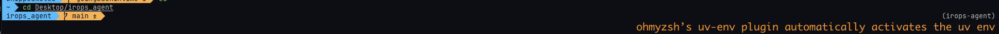
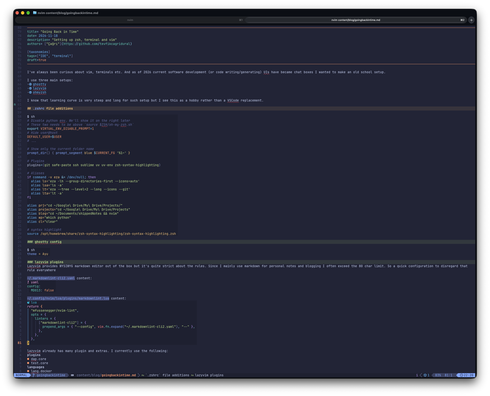
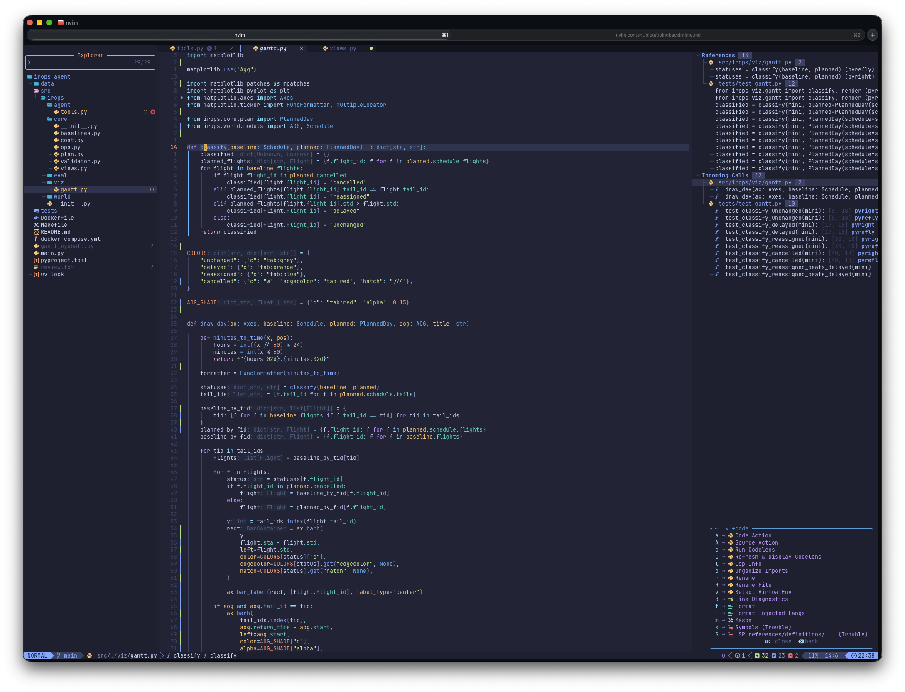

+++
title= "Going Back in Time"
date= 2026-11-18
description= "Setting up zsh, terminal and neovim"
draft= false
authors= ["Çağrı"]

[taxonomies]
tags=["IDE", "terminal"]
+++

I've always been curious about vim, terminals etc. And as of 2026 current software development (or code writing/generating) UIs have became chat boxes I wanted to make an old school setup.

I use three main setups:

- [ghostty](https://ghostty.org/)
- [lazyvim](https://www.lazyvim.org)
- [ohmyzsh](https://ohmyz.sh)

I know that learning curve is very steep and long for such setup but I see this as a hobby rather than a VSCode replacement.

## `.zshrc` file additions

```sh
# Disable python env. We'll show it on the right later
# These two needs to be above `source $ZSH/oh-my-zsh.sh`
export VIRTUAL_ENV_DISABLE_PROMPT=1
# Hide user@host
DEFAULT_USER=$USER
# ...

# Show only the current folder name
prompt_dir() { prompt_segment blue $CURRENT_FG '%1~' }

# Plugins
plugins=(git safe-paste ssh sublime uv uv-env zsh-syntax-highlighting)

# Aliases
if command -v eza &> /dev/null; then # As you can see I also installed eza
  alias ls='eza -lh --group-directories-first --icons=auto'
  alias lsa='ls -a'
  alias lt='eza --tree --level=2 --long --icons --git'
  alias lta='lt -a'
fi

alias prj="cd ~/Google\ Drive/My\ Drive/Projects/"
alias projects="cd ~/Google\ Drive/My\ Drive/Projects"
alias blog="cd ~/Documents/shippedNotes && nvim"
alias wp="which python"
alias cl="clear"

# syntax highlight
source /opt/homebrew/share/zsh-syntax-highlighting/zsh-syntax-highlighting.zsh
```

### ghostty config

```sh
theme = Ayu
```

### lazyvim plugins
**Plugins**
-util.dot Language support for dot files

**Enabled Languages**
- lang.docker
- lang.json
- lang.markdown
- lang.python
- lang.toml
- lang.yaml

### some screenshots







